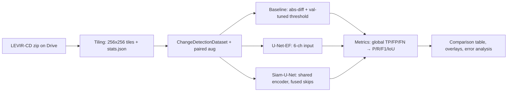
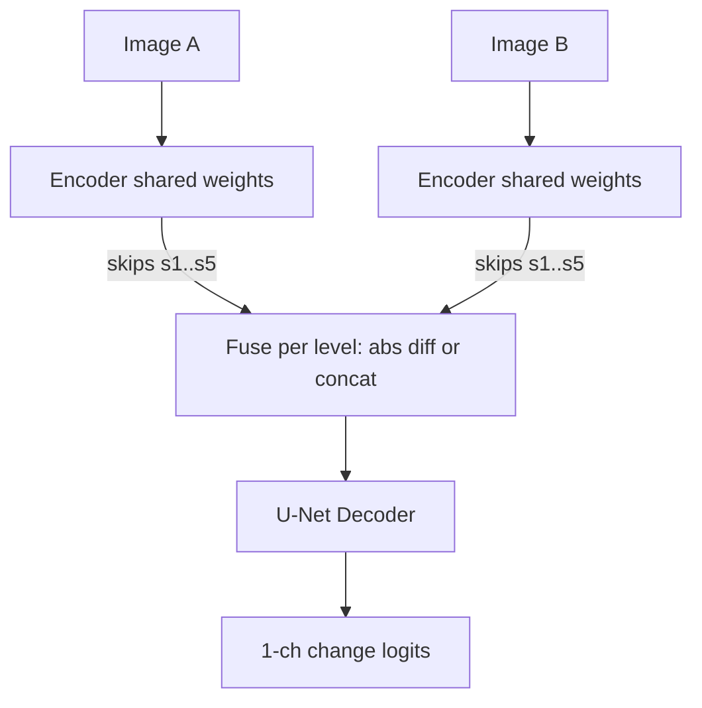

# Implementation Plan: Satellite Building Change Detection (LEVIR-CD)

CS57600 Machine Learning, Fall 2026. Team: Raviteja Gundu, Joel Adu-Kwarteng

## Problem Statement
Given two co-registered images of the same area taken at different times, predict a pixel-level building-change mask. Compare three models on LEVIR-CD: an image-difference baseline, an early-fusion U-Net and a Siamese U-Net. Then analyze where each one fails.

## Requirements
- Dataset: LEVIR-CD. 637 pairs of 1024×1024 images at 0.5 m/pixel, with the official 445/64/128 train/val/test split.
- Models:
  - Baseline: absolute pixel difference plus a threshold.
  - U-Net-EF: both images stacked as 6 input channels.
  - Siam-U-Net: a shared encoder with skip features fused per level.
  - Both U-Nets are written from scratch in PyTorch.
- Metrics: precision, recall, F1/Dice and IoU for the change class. These come from confusion counts summed over the whole test set. Qualitative success and failure examples go alongside them.
- Compute: Google Colab only, with the dataset stored on Google Drive. Nothing is run on the local Mac.
- Deliverable format: one self-contained notebook, `levir_change_detection.ipynb`, uploaded to Colab and run there. No package, no pip installs, no repo clone.
- Scope: core work only. No robustness experiment, no SpaceNet 7.
- Team split (assumed, can be changed):
  - Raviteja: data, EDA, metrics, baseline and evaluation.
  - Joel: training infrastructure and the two U-Nets.
- Midway Report (date to be confirmed): baseline and U-Net-EF results ready by then (Tasks 1–8).

## Background and Design Decisions
- Single notebook, built incrementally: each task appends one section (`## Task N · …`). After each task the updated notebook is re-uploaded to Colab.
- Configuration: one `CONFIG` dict in the setup section holds paths, seed and per-task settings (data, baseline, each model's training settings). No YAML files.
- Run control: "Run all" must be safe in every session. Expensive steps (tiling, stats, training, test evaluation) skip when their outputs already exist on Drive, and a `RUN` dict of on/off flags picks which training runs execute.
- LEVIR-CD comes as `train/val/test/{A,B,label}/*.png`. Labels use 0/255, and only about 5% of pixels show change, so the classes are heavily imbalanced.
- Each 1024×1024 image is cut into 16 non-overlapping 256×256 tiles once and saved to Drive as a zip. Each session copies the zip to the VM's local disk, because reading thousands of small files from Drive is slow. That gives 7,120 training tiles and fits T4 memory. Because the tiles don't overlap, metrics summed over all test tiles equal metrics over the full images.
- Imbalance handling: the loss is BCE plus Dice. The baseline threshold and the model decision threshold are tuned on val, never on test.
- Augmentation: random flips and 90° rotations, applied identically to A, B and the label. Normalization uses per-channel mean and std computed from the training set during EDA.
- Both U-Nets use the same channel widths (32→64→128→256→512) so the comparison is fair, and parameter counts are reported. Siam-U-Net fusion is a config option: `diff` is the primary run (|f_A − f_B|, as in FC-Siam-diff) and `concat` is an optional extra run.
- Colab constraints are sessions of 12 hours or less and possible disconnects. To cope, a checkpoint is saved to Drive every epoch (model, optimizer, scheduler, epoch number, best F1), and runs resume automatically. Mixed-precision training (AMP) is on. Logs are CSV files, with no external tracking service.
- Dependencies: only what Colab preinstalls (torch, torchvision, numpy, pillow, matplotlib). Nothing is installed.
- Testing: no unit tests. Each task is checked by running its section in Colab and checking the demo output.





## Repository Layout
```
levir_change_detection.ipynb   the whole project, one section per task
README.md, LICENSE, .gitignore
docs/                          plan and course documents (not pushed to GitHub)
```

Drive layout (project root `/content/drive/MyDrive/levir-change-detection`):
```
data/raw/        LEVIR-CD as downloaded: train/val/test/{A,B,label}
data/tiles.zip   256x256 tiles (Task 3)
data/stats.json  training-set channel mean/std (Task 4)
runs/<name>/     checkpoints, CSV logs, saved config
results/         metrics JSON, per-image CSVs, figures
```

## Execution Constraint
Code is written locally but never run locally (no Python, pip or notebooks on the Mac). Every task ends with steps the user runs in Colab. No git commits unless asked.

## Task Breakdown

### - [x] Task 1: Notebook skeleton and Colab setup (Raviteja)
- Objective: a notebook that runs on Colab and sets up the session.
- Guidance:
  - Setup section: GPU check, Drive mount, imports, `CONFIG` dict, helpers (seeding, DataLoader worker seeding, device selection, project paths and folder creation), and a summary printout.
  - README describes how to upload and run the notebook. `.gitignore` covers data, checkpoints and outputs.
- Demo: in Colab, the setup section prints the T4 GPU, `CUDA available: True` and the Drive folders.

### - [x] Task 2: Metrics (Raviteja)
- Objective: correct, reusable segmentation metrics.
- Guidance:
  - `ConfusionAccumulator` takes in batches of predicted and true binary masks (torch or numpy) and keeps running TP/FP/FN/TN counts.
  - `compute()` returns precision, recall, F1, IoU and overall accuracy, with safe handling of zero denominators.
  - Also add a per-image metric helper.
- Demo: a cell prints metrics for a hand-computed toy example and they match.

### - [x] Task 3: Data preparation and dataset (Raviteja)
- Objective: tiled, loadable training data.
- Guidance:
  - Source: Kaggle mirror `mdrifaturrahman33/levir-cd` (`LEVIR CD/{train,val,test}/{A,B,label}`), downloaded with `kagglehub` to local disk. A copy in `data/raw` on Drive takes precedence.
  - Check the dataset layout, cut each A/B/label triple into 16 tiles of 256×256 (names like `{image}_{row}_{col}.png`), binarize labels to 0/1, zip the tiles to Drive, and copy/unzip them to local disk each session. Skip tiling if the zip exists.
  - `ChangeDetectionDataset(split, root, transform, stats)` returns `(A, B, mask, name)`.
  - Paired flips and 90° rotations plus normalization.
- Demo: display a batch with A, B and the mask side by side.

### - [x] Task 4: EDA (Raviteja)
- Objective: understand the data and produce the normalization stats.
- Guidance:
  - Image and tile counts per split, the fraction of changed pixels per split and per image (histogram), the share of tiles with no change, and sample pairs.
  - Per-channel mean and std over the training set, saved to `stats.json` on Drive (skipped if it exists). The dataset loads this file.
  - Figures are saved to `results/figures/` for the report.
- Demo: the imbalance statistics and figures, plus a `stats.json` the dataset reads.

### - [ ] Task 5: Image-difference baseline (Raviteja)
- Objective: the first benchmark numbers.
- Guidance:
  - Per-pixel L2 norm of |A − B| across channels, with optional Gaussian smoothing, then a threshold.
  - The threshold is picked by sweeping candidates on val to maximize F1. Otsu thresholding is reported as an extra reference.
  - Settings come from `CONFIG["baseline"]`. Results go to `results/baseline.json` plus overlay images.
- Demo: baseline P/R/F1/IoU on the test set, with sample overlays.

### - [ ] Task 6: Training infrastructure (Joel)
- Objective: a training loop that works with any model, can be resumed, and has been checked on a stand-in model.
- Guidance:
  - BCE plus Dice loss (both weights configurable).
  - A model registry, `build_model(cfg)`, with a tiny `DummyCD` model for now.
  - Training loop: AdamW, a cosine learning-rate schedule, AMP, gradient clipping, and per-epoch validation with `ConfusionAccumulator`.
  - Each epoch it saves `last.pt` to Drive, plus `best.pt` whenever val F1 improves. A run resumes automatically if `last.pt` exists. Per-epoch metrics go to a CSV.
  - A `RUN` flag per training run controls whether it executes on "Run all".
- Demo: a short `DummyCD` run on real tiles shows the loss dropping. After an interrupt and restart, it resumes from the checkpoint.

### - [ ] Task 7: U-Net-EF model (Joel)
- Objective: the first neural model, trained.
- Guidance:
  - Shared building blocks: DoubleConv (conv, batch norm, ReLU, twice), Down, Up (transposed conv plus skip concat) and OutConv.
  - U-Net-EF: 6 input channels, widths 32 to 512, 1 output logit.
  - Register it and add `CONFIG["runs"]["unet_ef"]` (batch 16, lr 1e-3, 150 epochs). `DummyCD` stays registered until the Task 6 demo has passed.
  - Train it on Colab over as many sessions as needed. Each Run all trains for at most `CONFIG["session_minutes"]` (150), saves, then continues to evaluation; the next session resumes.
- Demo: training curves (from the CSV), plus the best val F1 and IoU.

### - [ ] Task 8: Evaluation and first comparison (Raviteja). Milestone: Midway Report
- Objective: a single evaluation path for every method.
- Guidance:
  - Load a checkpoint and tune the decision threshold on val (default 0.5 if not tuned). Then run on the test tiles and compute global and per-image metrics, writing them to `results/{run}.json` and `results/{run}_per_image.csv`. Finally stitch tiles back into full 1024×1024 predictions.
  - Overlays: true positives in white, false positives in red, false negatives in blue.
  - A comparison table built from all the results JSON files (baseline and U-Net-EF for now).
- Demo: a test-set table comparing the baseline and U-Net-EF, with overlays. This is the content for the Midway Report.

### - [ ] Task 9: Siamese U-Net (Joel)
- Objective: the late-fusion model, trained and evaluated.
- Guidance:
  - A shared `Encoder` returning skips s1–s5. Each level is fused as `diff` (|a − b|, same channel count) or `concat` (doubled channels, with matching decoder input widths). The decoder reuses the Task 7 blocks.
  - Register it and add `CONFIG["siam_unet_diff"]`, plus `CONFIG["siam_unet_concat"]` as an optional run.
  - Train it, then evaluate it with Task 8's code.
- Demo: Siam-U-Net added to the comparison table, with overlays.

### - [ ] Task 10: Final analysis and report assets (Raviteja leads, Joel reviews)
- Objective: the material behind the report's conclusions.
- Guidance:
  - The analysis section covers:
    - the final table (P/R/F1/IoU, parameter count, training time)
    - training curves for all models
    - per-image F1 distributions
    - F1 by changed-area bucket (small, medium, large)
    - the best and worst examples for each model
    - a manually tagged set of failure categories, such as small buildings, shadows and seasonal or lighting change, misregistration, and construction sites
  - All figures are exported to `results/figures/` for the presentation and report.
- Demo: one section that produces every table and figure for the final report.

## Open Questions
- Midway Report due date.
- Confirm the work split between Raviteja and Joel.
- Any course-required reporting format or F1 definition.
- Reference design for the U-Nets (default: Daudt et al. 2018, FC-EF / FC-Siam-diff).
